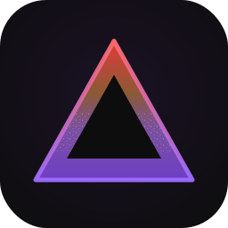

<p align="center">
  
</p>

<h1 align="center">Shuggle</h1>

<p align="center">
  <strong>Free &bull; Uncensored &bull; Zero Local Compute</strong><br/>
  Your chats run on Kaggle's GPUs. Your data never leaves your disk.
</p>

<p align="center">
  
  
  
</p>

---

**Jump to:** [What Is Shuggle?](#what-is-shuggle) · [How It Works](#how-it-works) · [Features](#features) · [The Model](#the-model) · [Token System](#token-system) · [First Run](#first-run) · [CLI](#cli) · [Documentation](#documentation) · [FAQ](#faq)

---

## What Is Shuggle?

Shuggle is a native C++ desktop app that gives you a real ChatGPT-class chatting experience **for totally free** — not a subscription, not a trial, not a watered-down API tier. It runs an uncensored 27B model on **Kaggle's free GPU hours** (the two Tesla T4s Kaggle gives every account, 30 hours every week), and the whole thing feels local: you open the app, you pick a chat, you type, the answer streams in.

It is what you would get if a local LLM app like Ollama's GUI and a polished web chat like DeepSeek had a baby, and that baby refused to pay for anything. The model is not local — but everything else is: chats, memories, settings, attachments and downloads live on your disk in plain files, and nothing is sent anywhere except to the notebook you own on your own Kaggle account.

Shuggle is for people who want a big, uncensored, thinking model with a clean interface, zero local compute, and zero cost — and who have a Kaggle account, because that is literally the only requirement.

## How It Works

One private Kaggle notebook (the **Shuggle Engine**) is created on *your* account, configured by the app, and started on **GPU T4 x2**. It loads the model, boots an OpenAI-compatible server, and opens an encrypted-style tunnel back to your machine. The app talks to that tunnel directly — streaming, thinking blocks, elapsed timers, the whole experience — and manages the notebook's full lifecycle for you: boot, heartbeat, inactivity shutdown, quota tracking, restarts.

```
Shuggle (your machine)                Kaggle (your account)
──────────────────────                ─────────────────────────
  chat UI  ──stream──► tunnel ◄── llama-server on T4 x2
     │                                   ▲
     │  push / poll / logs / quota       │
     └────────► Kaggle API ─────────────►┘
```

- **Control plane** — the app pushes and monitors the notebook through Kaggle's official API.
- **Data plane** — your messages stream straight to the running notebook over its tunnel, protected by a per-boot access key.
- **The watchdog** — walk away for 3 minutes and the notebook politely saves, stops, and gives your GPU hours back. Come back (or keep typing — the app heartbeats your activity up to 6 minutes) and it semi-cold-starts in under a minute, history intact, because history was never on Kaggle in the first place.

## Features

- **Real streaming chat** — token-by-token answers, elapsed generation timer, copy everything, regenerate any reply.
- **Branching that makes sense** — retry an older message and Shuggle opens an **in-session branch** instead of shredding your chat. Switch between branches with `‹ 2/3 ›`, or branch out to a fresh session carrying the full context up to that point.
- **Thinking blocks** — the model's internal reasoning is captured in a collapsible block with a global show/hide switch.
- **Markdown that respects languages** — full markdown rendering with proper RTL/bidi support (yes, Arabic renders correctly).
- **Run the code it writes** — one click sends a code block to a Terminal / cmd / PowerShell / bash runtime with live output, Clear, and a real Ctrl+C. Python runtime detection: the button grays itself out with an honest hover note if Python isn't installed.
- **Web search, engineered not vibes** — an on/off toggle per chat. A fixed pipeline (not an agent): the model plans up to a few queries, the notebook fetches unfiltered results, a summarization layer compresses them into exactly what your question needs, and the answer cites what it used. The search prompt lives separately from your system prompt.
- **Shared memory** — one memory file, shared across sessions, toggleable and editable per session. Optional (off by default) memory *tools* let the model create / edit / delete / undo memories itself — single-shot ops, no agent loops, no tool-call APIs.
- **File attachments** — UTF-8 files ride inside the prompt and show as attachment chips. Clipped content is *refused*, never silently truncated.
- **Dual-chat mode** — pick two sessions, run them side by side, broadcast one message to both or talk to each separately. Perfect for comparing system prompts, temperatures, or your own branches.
- **Local everything** — sessions, memory, tokens, settings, downloads: plain files in the app folder. Downloads land in per-session folders with obvious names. Deleting a chat in the app deletes it on your disk — Kaggle never held it.

## The Model

| | |
|---|---|
| **Model** | [Qwen3.8-27B-Uncensored](https://huggingface.co/JonathanColetti/Qwen3.8-27B-Uncensored-GGUF) |
| **Quantization** | Q4_K_M (~16 GB) |
| **Hardware** | 2× Tesla T4 (Kaggle free tier) |
| **Context window** | 32,768 – 75,000 tokens (hard ceiling: the T4s say no) |
| **Thinking** | Supported, toggleable |
| **Future** | The Qwen 4 drop replaces it — one setting, same app |

## Token System

- Add up to **100 Kaggle API tokens**. Shuggle introspects every token, rejects dead ones, rejects duplicates, and enforces **one token per account** (same account behind two tokens → the second is refused).
- Each token's **GPU quota is queried live**: used hours, remaining hours, and the exact weekly reset moment (Kaggle's window resets Saturday 00:00 UTC).
- A token that hits the 30h wall is **flagged exhausted** until the next weekly reset — automatically, honestly, no guessing.
- Sessions **auto-pick** the healthiest token: most remaining hours wins. Run out of hours everywhere and Shuggle tells you exactly when life gets good again.
- Live usage meters per token and pooled — refreshed continuously, not vibes.
- A big friendly **"?" window** walks you through creating a token step by step, from the Kaggle settings page to pasting it in.

## First Run

1. Grab the latest artifact for your OS from the [releases](https://github.com/HAKORADev/Shuggle/releases) (or the Actions artifacts while we're in alpha).
2. Extract the folder — like all my tools, it's a single binary in a folder, nothing sprawls.
3. Run `shuggle` (GUI) or `shuggle-cli`. The first-run wizard asks for a Kaggle token (the **?** button helps if you've never made one), your name/country/time basics for the dynamic system prompt, and that's it.
4. New chat. Type. Watch the T4s do your homework.

> **What the app does with your token:** it creates one private notebook and up to a couple of private sync datasets on the token's own account, starts and stops them, and reads their logs. That's the whole list. Your token never leaves your machine except to talk to Kaggle itself.

## CLI

Interactive mode is deliberately simple — chat, switch sessions, quit. No search, no terminal runtimes, no complexity; the GUI owns the fancy stuff.

The one-liner speaks fluent VODER:

```bash
shuggle chat "explain quantum tunneling like I'm five" session "physics"
shuggle ask "what is 2+2?" --new
shuggle chat "continue" session "physics" temperature 0.9
```

Orders and quotes, human-readable, no flags required unless you want them.

## Documentation

| Document | What's Inside |
|----------|--------------|
| [CHANGELOG.md](CHANGELOG.md) | Version history |
| [LICENSE](LICENSE) | MIT — use it, fork it, learn from it |

## FAQ

**Is the model really free?** Yes. Kaggle gives every account 30 free GPU hours per week. Shuggle uses *your* hours, on *your* account, and adds more accounts (tokens) if you have them.

**Is my data on Kaggle?** Your chats never are. The notebook receives your current conversation context to answer (that's how chatting works), then the watchdog shuts it down. History lives in the app folder.

**Why 75K context ceiling?** Not the model's limit — the T4s' VRAM limit. Ask Kaggle for H100s and we'll talk.

**Windows and Linux?** Both, from one identical codebase. Same bugs on both platforms, by design — fixes land everywhere at once.

**Does it phone home?** No. No telemetry, no accounts with us, no update pings. The only network Shuggle touches is Kaggle's API, your notebooks, and whatever search the notebook fetches when you toggle it on.

## Contributing

Shuggle is open-source under [MIT](LICENSE). Pull requests are not accepted — the codebase is maintained by a single developer (with a very talkative AI pair programmer). Issues, bug reports, and feature ideas are very welcome. Want it your way? Fork it.

---

*Built for people who think free compute should feel premium.*
